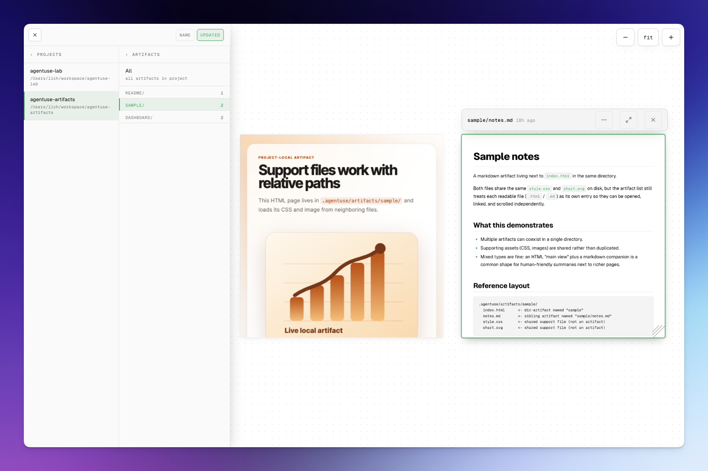

<h1 align="center">@agentuse/artifacts</h1>

<p align="center">
  <strong>A local-first artifact feed for AI agents.</strong><br/>
  Agents submit reports, dashboards, screenshots, and plans. You browse them newest-first, on your laptop or your phone.
</p>

<p align="center">
  <a href="https://www.npmjs.com/package/@agentuse/artifacts"></a>
  <a href="https://nodejs.org"></a>
  <a href="LICENSE"></a>
</p>

<p align="center">
  
</p>

AI agents produce useful files, but those files end up buried in a transcript or scattered across a project. `@agentuse/artifacts` gives agents one command to publish a deliverable, and gives you one page to read everything they made.

Version 0.4.0 replaces file discovery with an explicit submit step. An agent runs `artifacts submit <path>`; the CLI copies the file, or the whole directory, assets included, into a local store and appends one line to a feed log. The viewer is a reverse-chronological feed of those submissions, filterable by project and tag, and laid out for a phone first.

## Install

Install the Skill for your coding agent:

```bash
npx skills add agentuse/artifacts
```

Install it globally if you want every project to use the same artifact behavior:

```bash
npx skills add agentuse/artifacts -g
```

Optionally install the CLI globally so the viewer starts instantly:

```bash
npm install -g @agentuse/artifacts
```

Requires Node.js 20+.

## Use With Different Agents

`@agentuse/artifacts` is agent-agnostic. There are two ways to use it:

| Agent type | Recommended setup |
| --- | --- |
| Claude Code, Cursor, Codex, Windsurf, Cline, and other interactive coding agents | Install the Skill with `npx skills add agentuse/artifacts`, then ask the agent to save reports or dashboards as artifacts. |
| AgentUse and other async/scheduled agents | Install the same Skill globally with `npx skills add agentuse/artifacts -g`, then let the agent submit its output when a run finishes. |
| Custom runners, CI jobs, and shell scripts | Call `npx @agentuse/artifacts submit <path> --tag <tag>` at the end of the job. No setup step is needed. |
| Remote VMs or chat-based agents | Run the viewer on the machine where artifacts are written. It binds to `127.0.0.1:7878`; use SSH port forwarding, Tailscale Serve, or another private tunnel to view it from your laptop. |

If the `skills` CLI does not know your agent yet, copy `skills/agentuse-artifacts/SKILL.md` into that agent's skill or instruction directory. The underlying contract is just files on disk plus the local viewer.

## Use

Ask your agent to save something as an artifact:

```text
save this report as an artifact
render this plan as a viewable HTML artifact
/agentuse-artifacts drop this to artifacts
```

The agent writes the file, then submits it:

```bash
npx @agentuse/artifacts submit tmp/customer-report --tag client-acme
```

A directory is submitted as one bundle: `index.html` plus its CSS, images, and fonts, so relative paths keep working. A single file works too. `submit` prints the artifact's URL.

Open the feed:

```bash
npx @agentuse/artifacts open
```

The viewer renders Markdown, AgentUse `.agentuse`, HTML, PNG/JPG/WebP, and PDF. HTML artifacts are sanitized and loaded in a sandboxed iframe.

### Share an artifact

Open an artifact and click **Share**. The local server uploads the stored revision
and its bundled files, then the viewer copies a unique cloud URL to your clipboard.
Anyone with the link can view it without signing in. If clipboard access is blocked,
the viewer shows the URL and a **Copy link** button.

Sharing requires a configured Artifacts Cloud service. Set these environment
variables on the local server, then restart it:

```bash
export ARTIFACTS_CLOUD_URL=https://api.example.com
export ARTIFACTS_CLOUD_API_KEY='<your-upload-key>'
npx @agentuse/artifacts serve
```

The upload key stays on the local server. The viewer never receives it. Sharing
the same revision again reuses its active link; sharing another revision creates
a new snapshot. Links and their management IDs are cached in the local storage
root's `share-cache/` directory. Revoked or expired links are replaced on the next
share. The cloud backend is maintained separately in the private
`agentuse-artifacts-cloud` repository.

Submit a directory to include supplementary files. CSV, TSV, text, Office
documents (`.xlsx`, `.docx`, `.pptx`), ZIP files, PDFs, and supported visual assets
are retained with the bundle. Reference them using relative links such as
`./supplements/data.csv`. Files outside the submitted directory are not uploaded.
The existing 25 MiB and 200-file bundle limits apply. The initial cloud renderer
also limits HTML/Markdown files to 2 MiB and displays static content: scripts and
external CDN resources are blocked, so JavaScript dashboards may differ from the
local viewer.

## What 0.4.0 Changes

- **Submit replaces discovery.** Artifacts reach the feed because an agent submitted them, not because a scanner found them. No more whole-project filesystem walks on every poll.
- **The viewer is a feed.** One reverse-chronological column, filter chips for project and tag, search, and a detail page per artifact. The pan/zoom canvas is gone.
- **Built for a phone.** Single column, 44px touch targets, lazy previews, pinch-zoom re-enabled.
- **Artifacts are copied, not referenced.** A feed entry is a snapshot: it still opens after the source file is edited, gitignored away, or deleted with the branch.
- **Revisions are free.** Re-submitting the same slug adds a revision; identical content is a no-op, so re-runs don't spam the feed.
- Settings, ignore patterns, and the project-scan cap are gone with the scanner that needed them.
- **No project registry.** Nothing has to be registered. A project is whatever the feed reports, so `manifest.json`, `artifacts init`, and `project add`/`project prune` are gone.

## Storage

```text
~/.agentuse/artifacts/
  feed.jsonl                              append-only submission log
  store/<projectId>/<slug>/<rev>/         copied bundles
  preview-cache/
  .serve.pid
```

Set `AGENTUSE_ARTIFACTS_HOME` to use a different storage root.

Every re-submit writes a new revision, so the store grows. `artifacts prune` keeps the newest 5 revisions per artifact and deletes the rest.

### Migrating from 0.3.x

Artifacts that lived in a project-local `.agentuse/artifacts/` folder are no longer discovered automatically. Publish them once per project:

```bash
npx @agentuse/artifacts import
```

## CLI

Every command supports `--json`.

| Command | Description |
| --- | --- |
| `artifacts submit <path> [--title T] [--tag T...] [--slug S] [--open]` | Copy a file or directory into the store and add it to the feed. Prints the URL. |
| `artifacts feed [--project ID] [--tag T] [--limit N] [--all-revisions]` | List submitted artifacts, newest first. |
| `artifacts import [dir]` | Submit everything already in the project-local `<dir>/.agentuse/artifacts/`. |
| `artifacts prune [--keep N]` | Delete superseded revisions from the store (default: keep 5). |
| `artifacts open [--port N] [--detach] [--no-browser]` | Start or reuse the viewer and open this project's feed. |
| `artifacts url [--all]` | Print the feed URL, filtered to the current project unless `--all`. |
| `artifacts serve [--port N] [--detach] [--stop] [--fail-if-running]` | Manage only the local viewer server. |
| `artifacts where` | Print the global storage path. |
| `artifacts project list` | List projects that have submitted artifacts, with counts. |
| `artifacts project forget <projectId>` | Delete every artifact from a project, feed lines and stored bundles. |

## Security

Stored HTML artifacts are treated as untrusted:

- HTML is parsed and sanitized at render time, so sanitizer fixes apply to artifacts already in the store.
- Rendered HTML gets a strict CSP with `connect-src 'none'`.
- HTML runs inside an iframe sandbox without `allow-same-origin`.
- Bundle paths are resolved inside the bundle root; `..` and encoded variants are rejected.

Do not relax these defaults casually. Artifacts are often generated from untrusted web pages, PRs, scraped docs, and model output.

The server binds to `127.0.0.1`. To read the feed from a phone, put a private tunnel in front of it (Tailscale Serve, SSH forwarding) rather than changing the bind address.

## Development

```bash
npm install
npm run build
npm test
npm run typecheck
```

For local development:

```bash
npm run dev:server
npm run dev:viewer
```

## License

[MIT](LICENSE) (c) 2026 Leon Ho.
